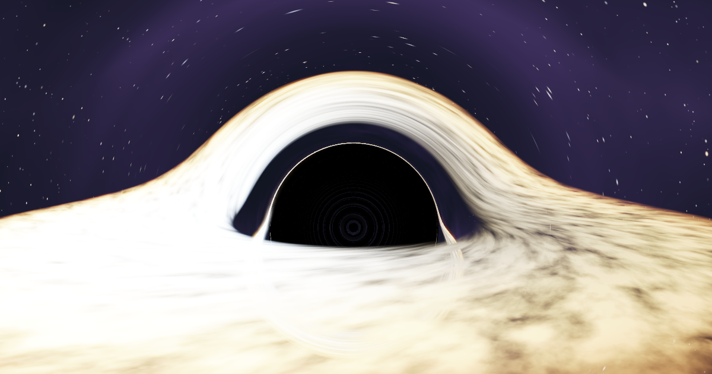

# Black hole simulator

Real-time ray tracing of light around Schwarzschild, Kerr and Taub-NUT black holes, in a single WebGL2 fragment shader. No build, no dependencies.

**Live: [blackhole.maxenceleguery.net](https://blackhole.maxenceleguery.net)**



## Why

It grew out of my ENSTA Paris research internship on the [quasinormal modes of curved spacetimes](https://bibnum.ensta.fr/9537/) ([solver code](https://github.com/maxenceleguery/pre-ensta-paris)). The report computes how black holes ring. This is the geometric-optics side of the same physics: what they look like, and how the shadow connects to the ringing.

## Pages

| Page | What it shows |
|---|---|
| [`index.html`](https://blackhole.maxenceleguery.net) | The ray tracer: lensing, accretion disk, photon ring and shadow for the three spacetimes |
| [`qnm.html`](https://blackhole.maxenceleguery.net/qnm.html) | Leaver's continued fraction evaluated in a shader, with click-to-snap root finding and ringdown sonification |
| [`gw.html`](https://blackhole.maxenceleguery.net/gw.html) | A gravitational-wave chirp: inspiral, merger, ringdown |
| [`binary.html`](https://blackhole.maxenceleguery.net/binary.html) | Lensing by a binary black hole (Brill-Lindquist initial data, two shadows) |

## How it works

- **One integrator, any metric.** Each ray is a null geodesic integrated from the Hamiltonian H = ½ g^μν p_μ p_ν. A spacetime only has to supply its inverse metric.
- **Kerr-Schild coordinates.** Kerr is written in Cartesian Kerr-Schild form, so there is no coordinate singularity at the horizon and Schwarzschild is just Kerr with spin 0. The hot loop is matrix-free: H = ½(η(p,p) − f(l·p)²).
- **Taub-NUT** has no Kerr-Schild form, so it gets its own trace in spherical coordinates with an analytic inverse metric. The Misner string sits on the south axis, in the same gauge as the report. The UI reads out the result: the Taub-NUT shadow is shifted rigidly by 2l, while Kerr's is deformed into a D shape.
- **Disk and image.** The accretion disk has a blackbody temperature, Doppler beaming and gravitational redshift. The image goes through HDR bloom, ACES tonemapping and supersampling.

## Checks

The shader math is mirrored in plain JavaScript and checked with Node:

```sh
node test_metric.mjs     # scalar hot-loop metric == full 4x4 metric
node test_qnm.mjs        # continued fraction lands on known Leaver QNM values
node eikonal_check.mjs   # Taub-NUT QNMs vs the photon-sphere Lyapunov exponent
```

The last one checks that the Taub-NUT scalar quasinormal frequency tracks the instability of the photon orbit. The ratio is about 1.00 for small NUT charge and drifts to 0.68 at l = 2.

## Run locally

Open `index.html` in a browser with WebGL2. `run.sh` launches it on the discrete Nvidia GPU of a NixOS hybrid-graphics laptop, where browsers otherwise pick the Intel GPU.
